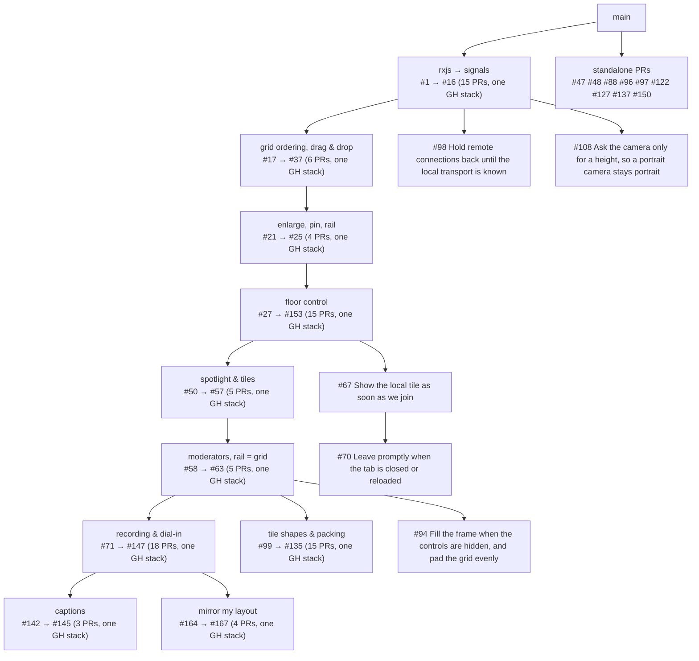

# The experiment stack

An overview of the PRs behind
[element-call-experiment.netlify.app](https://element-call-experiment.netlify.app),
grouped by topic. `matthew/experiment` is the merge of every branch below plus
two deployment-only commits that point the Netlify config at the recording,
SIP and transcription bot (`recording_bot`, `sip_bridge`, `transcription_bot`
in `config/config_netlify_preview.json`); without them the record and
captions controls don't appear on the deployed site.

## How the PRs relate

The first fifteen PRs turn the app's reactive core from rxjs into signals and
are a single linear GitHub stack; everything else is based on that. The later
work all edits the same handful of files (the call view model, the tile
components), so it forms a tree of stacks rather than independent branches:
within a stack each PR is based on the one before it, and each stack is based
on the tip of the one above it. Leaves are single PRs based on a stack's tip.
In the tables, a PR's **Base** column names the PR it must land after.

The same dependency tree as a bullet list, one PR set per node (a set marked
"GH stack" is one linear GitHub stack, listed in order):

- `main`
  - [**rxjs → signals**](#from-rxjs-to-signals) (GH stack): [#1](https://github.com/element-hq/element-call-experiment/pull/1), [#2](https://github.com/element-hq/element-call-experiment/pull/2), [#3](https://github.com/element-hq/element-call-experiment/pull/3), [#4](https://github.com/element-hq/element-call-experiment/pull/4), [#5](https://github.com/element-hq/element-call-experiment/pull/5), [#6](https://github.com/element-hq/element-call-experiment/pull/6), [#7](https://github.com/element-hq/element-call-experiment/pull/7), [#8](https://github.com/element-hq/element-call-experiment/pull/8), [#9](https://github.com/element-hq/element-call-experiment/pull/9), [#10](https://github.com/element-hq/element-call-experiment/pull/10), [#11](https://github.com/element-hq/element-call-experiment/pull/11), [#12](https://github.com/element-hq/element-call-experiment/pull/12), [#13](https://github.com/element-hq/element-call-experiment/pull/13), [#15](https://github.com/element-hq/element-call-experiment/pull/15), [#16](https://github.com/element-hq/element-call-experiment/pull/16)
    - [#98](https://github.com/element-hq/element-call-experiment/pull/98) [Hold remote connections back until the local transport is known](#recording-and-dial-in) (single PR)
    - [#108](https://github.com/element-hq/element-call-experiment/pull/108) [Ask the camera only for a height, so a portrait camera stays portrait](#tile-shapes-and-packing) (single PR)
    - [**grid ordering, drag & drop**](#grid-ordering-drag-and-drop) (GH stack): [#17](https://github.com/element-hq/element-call-experiment/pull/17), [#19](https://github.com/element-hq/element-call-experiment/pull/19), [#20](https://github.com/element-hq/element-call-experiment/pull/20), [#152](https://github.com/element-hq/element-call-experiment/pull/152), [#151](https://github.com/element-hq/element-call-experiment/pull/151), [#37](https://github.com/element-hq/element-call-experiment/pull/37)
      - [**enlarge, pin, rail**](#enlarging-pinning-and-the-spotlight) (GH stack): [#21](https://github.com/element-hq/element-call-experiment/pull/21), [#22](https://github.com/element-hq/element-call-experiment/pull/22), [#24](https://github.com/element-hq/element-call-experiment/pull/24), [#25](https://github.com/element-hq/element-call-experiment/pull/25)
        - [**floor control**](#floor-control) (GH stack): [#27](https://github.com/element-hq/element-call-experiment/pull/27), [#28](https://github.com/element-hq/element-call-experiment/pull/28), [#29](https://github.com/element-hq/element-call-experiment/pull/29), [#30](https://github.com/element-hq/element-call-experiment/pull/30), [#32](https://github.com/element-hq/element-call-experiment/pull/32), [#33](https://github.com/element-hq/element-call-experiment/pull/33), [#34](https://github.com/element-hq/element-call-experiment/pull/34), [#35](https://github.com/element-hq/element-call-experiment/pull/35), [#39](https://github.com/element-hq/element-call-experiment/pull/39), [#40](https://github.com/element-hq/element-call-experiment/pull/40), [#41](https://github.com/element-hq/element-call-experiment/pull/41), [#43](https://github.com/element-hq/element-call-experiment/pull/43), [#44](https://github.com/element-hq/element-call-experiment/pull/44), [#45](https://github.com/element-hq/element-call-experiment/pull/45), [#153](https://github.com/element-hq/element-call-experiment/pull/153)
          - [#67](https://github.com/element-hq/element-call-experiment/pull/67) [Show the local tile as soon as we join](#deployment-and-polish) (single PR)
            - [#70](https://github.com/element-hq/element-call-experiment/pull/70) [Leave promptly when the tab is closed or reloaded](#deployment-and-polish) (single PR, on #67)
          - [**spotlight & tiles**](#enlarging-pinning-and-the-spotlight) (GH stack): [#50](https://github.com/element-hq/element-call-experiment/pull/50), [#51](https://github.com/element-hq/element-call-experiment/pull/51), [#52](https://github.com/element-hq/element-call-experiment/pull/52), [#56](https://github.com/element-hq/element-call-experiment/pull/56), [#57](https://github.com/element-hq/element-call-experiment/pull/57)
            - [**moderators, rail = grid**](#floor-control) (GH stack): [#58](https://github.com/element-hq/element-call-experiment/pull/58), [#59](https://github.com/element-hq/element-call-experiment/pull/59), [#62](https://github.com/element-hq/element-call-experiment/pull/62), [#65](https://github.com/element-hq/element-call-experiment/pull/65), [#63](https://github.com/element-hq/element-call-experiment/pull/63)
              - [#94](https://github.com/element-hq/element-call-experiment/pull/94) [Fill the frame when the controls are hidden, and pad the grid evenly](#recording-and-dial-in) (single PR)
              - [**recording & dial-in**](#recording-and-dial-in) (GH stack): [#71](https://github.com/element-hq/element-call-experiment/pull/71), [#72](https://github.com/element-hq/element-call-experiment/pull/72), [#73](https://github.com/element-hq/element-call-experiment/pull/73), [#74](https://github.com/element-hq/element-call-experiment/pull/74), [#75](https://github.com/element-hq/element-call-experiment/pull/75), [#76](https://github.com/element-hq/element-call-experiment/pull/76), [#80](https://github.com/element-hq/element-call-experiment/pull/80), [#79](https://github.com/element-hq/element-call-experiment/pull/79), [#82](https://github.com/element-hq/element-call-experiment/pull/82), [#83](https://github.com/element-hq/element-call-experiment/pull/83), [#87](https://github.com/element-hq/element-call-experiment/pull/87), [#89](https://github.com/element-hq/element-call-experiment/pull/89), [#90](https://github.com/element-hq/element-call-experiment/pull/90), [#91](https://github.com/element-hq/element-call-experiment/pull/91), [#92](https://github.com/element-hq/element-call-experiment/pull/92), [#139](https://github.com/element-hq/element-call-experiment/pull/139), [#140](https://github.com/element-hq/element-call-experiment/pull/140), [#147](https://github.com/element-hq/element-call-experiment/pull/147)
                - [**captions**](#transcription-and-captions) (GH stack): [#142](https://github.com/element-hq/element-call-experiment/pull/142), [#144](https://github.com/element-hq/element-call-experiment/pull/144), [#145](https://github.com/element-hq/element-call-experiment/pull/145)
                - [**mirror my layout**](#mirror-my-layout) (GH stack): [#164](https://github.com/element-hq/element-call-experiment/pull/164), [#165](https://github.com/element-hq/element-call-experiment/pull/165), [#166](https://github.com/element-hq/element-call-experiment/pull/166), [#167](https://github.com/element-hq/element-call-experiment/pull/167)
              - [**tile shapes & packing**](#tile-shapes-and-packing) (GH stack): [#99](https://github.com/element-hq/element-call-experiment/pull/99), [#101](https://github.com/element-hq/element-call-experiment/pull/101), [#106](https://github.com/element-hq/element-call-experiment/pull/106), [#107](https://github.com/element-hq/element-call-experiment/pull/107), [#113](https://github.com/element-hq/element-call-experiment/pull/113), [#115](https://github.com/element-hq/element-call-experiment/pull/115), [#116](https://github.com/element-hq/element-call-experiment/pull/116), [#119](https://github.com/element-hq/element-call-experiment/pull/119), [#120](https://github.com/element-hq/element-call-experiment/pull/120), [#121](https://github.com/element-hq/element-call-experiment/pull/121), [#123](https://github.com/element-hq/element-call-experiment/pull/123), [#128](https://github.com/element-hq/element-call-experiment/pull/128), [#154](https://github.com/element-hq/element-call-experiment/pull/154), [#129](https://github.com/element-hq/element-call-experiment/pull/129), [#135](https://github.com/element-hq/element-call-experiment/pull/135)
  - **standalone** (each its own PR off `main`):
    - [#47](https://github.com/element-hq/element-call-experiment/pull/47) [Deploy matthew/experiment to Netlify from GitHub Actions](#deployment-and-polish) (single PR)
    - [#48](https://github.com/element-hq/element-call-experiment/pull/48) [Disable overscroll bounce at the page edges](#deployment-and-polish) (single PR)
    - [#88](https://github.com/element-hq/element-call-experiment/pull/88) [Pin nginx to its multi-arch index, not the 32-bit image](#recording-and-dial-in) (single PR)
    - [#96](https://github.com/element-hq/element-call-experiment/pull/96) [Bundle Twemoji so emoji render in WPE WebKit](#recording-and-dial-in) (single PR)
    - [#97](https://github.com/element-hq/element-call-experiment/pull/97) [Reconnect on request when the connection is lost, and log boundary errors fully](#recording-and-dial-in) (single PR)
    - [#122](https://github.com/element-hq/element-call-experiment/pull/122) [Shape the lobby's preview to the camera's video](#tile-shapes-and-packing) (single PR)
    - [#127](https://github.com/element-hq/element-call-experiment/pull/127) [Let the pointer through the footer to tiles beneath it](#grid-ordering-drag-and-drop) (single PR)
    - [#137](https://github.com/element-hq/element-call-experiment/pull/137) [Run LiveKit's TURN server in the dev stack](#deployment-and-polish) (single PR)
    - [#150](https://github.com/element-hq/element-call-experiment/pull/150) The experiment stack overview (this document, single PR)

Each table's Files and Lines columns count what the PR changes against its
base, excluding this overview and the lockfile.

## From rxjs to signals

**Problem.** The call's reactive core was written in rxjs. Deriving one value
from several streams took `combineLatest`, `switchMap` and `scan` pipelines,
glitches between them needed an Epoch tag to paper over, and the logic was
hard to read, hard to test and hard to change.

**Goal.** Every derived value is a `computed()`, every side effect an
`effect()`, and rxjs is gone from the app and SDK.

**Requirements.**

- No behaviour change: the app works as before, and the existing tests pass
  or are replaced by stronger ones.
- Derived values are glitch-free by construction, so no Epoch machinery.
- Layout decisions are pure functions of plain values.
- React reads state through a single `useBehavior` hook.

**PRs.**

| PR                                                                   | Title                                                               | Description                                                                                                                                                                                                       | Base   | Files |         Lines |
| -------------------------------------------------------------------- | ------------------------------------------------------------------- | ----------------------------------------------------------------------------------------------------------------------------------------------------------------------------------------------------------------- | ------ | ----: | ------------: |
| [#1](https://github.com/element-hq/element-call-experiment/pull/1)   | Back Behavior with signals                                          | `Behavior<T>` becomes an interface that both rxjs's BehaviorSubject and a new signal-backed State satisfy, so derived values can start being tracked by `computed()` while the rest of the app still speaks rxjs. | `main` |     9 |    +230 / -51 |
| [#2](https://github.com/element-hq/element-call-experiment/pull/2)   | Replace BehaviorSubject with State                                  | every writable Behavior becomes a signal-backed State, written with `.value = x` instead of `.next(x)`.                                                                                                           | #1     |    44 |   +328 / -364 |
| [#3](https://github.com/element-hq/element-call-experiment/pull/3)   | Derive media view model state with computed()                       | the per-participant media view models express their derived values as computeds instead of combineLatest/switchMap pipelines.                                                                                     | #2     |     9 |   +110 / -406 |
| [#4](https://github.com/element-hq/element-call-experiment/pull/4)   | Compute the call layout from signals                                | the chain from user media to layout (screen shares, spotlight speaker, grid order, PiP, window mode, layout flags) becomes a set of computeds.                                                                    | #3     |     5 |   +393 / -638 |
| [#5](https://github.com/element-hq/element-call-experiment/pull/5)   | Convert the remaining simple derivations to computed()              | the footer view model, media devices and the plain map/combineLatest derivations in CallViewModel read their inputs directly.                                                                                     | #4     |     8 |   +251 / -361 |
| [#6](https://github.com/element-hq/element-call-experiment/pull/6)   | Bridge React to Behaviors with useBehavior only                     | replaces every observable-hooks call with `useBehavior` and drops the observable-hooks dependency.                                                                                                                | #5     |    16 |    +92 / -124 |
| [#7](https://github.com/element-hq/element-call-experiment/pull/7)   | Remove Epoch by reconciling keyed items from signals                | `keyedItems()` diffs generated keys against existing items, giving each its own scope, which makes the Epoch consistency tag unnecessary since computeds always see a consistent snapshot.                        | #6     |    17 |   +477 / -815 |
| [#8](https://github.com/element-hq/element-call-experiment/pull/8)   | Replace rxjs event sources with fromEvents and effects              | Behaviors built from event emitters or LiveKit observables now use `fromEvents(scope, emitter, events, read)`, and timers live in effects.                                                                        | #7     |    49 | +1652 / -1907 |
| [#9](https://github.com/element-hq/element-call-experiment/pull/9)   | Rewrite MuteStates as states, computeds and an async sync loop      | the Observable-of-Observables mute machinery becomes an enabled state, a desired target and one loop that moves the device towards the target.                                                                    | #8     |     2 |   +123 / -189 |
| [#10](https://github.com/element-hq/element-call-experiment/pull/10) | Rewrite LocalTransport and LocalMember with computeds and effects   | the local member's publisher lifecycle, RTC membership, track pausing and analytics are driven by effects, and the transport exposes `error$` instead of failing its streams.                                     | #9     |     7 |   +406 / -526 |
| [#11](https://github.com/element-hq/element-call-experiment/pull/11) | Turn the remaining CallViewModel streams into Behaviors and effects | leaving, ringing, sound effects and the other remaining streams become Behaviors consumed by effects.                                                                                                             | #10    |    16 |  +654 / -1138 |
| [#12](https://github.com/element-hq/element-call-experiment/pull/12) | Drop rxjs: Behavior and State are preact signals                    | `Behavior<T>` is now `ReadonlySignal<T>` and `State<T>` is `Signal<T>`; the bridging classes and rxjs itself are removed from the app and SDK.                                                                    | #11    |    15 |   +207 / -436 |
| [#13](https://github.com/element-hq/element-call-experiment/pull/13) | Rename ObservableScope to Scope                                     | nothing in it is an Observable any more; it scopes effects, timers, listeners and async reconciliation.                                                                                                           | #12    |    59 |   +212 / -220 |
| [#15](https://github.com/element-hq/element-call-experiment/pull/15) | Make the layout decisions pure functions                            | `chooseSpotlightSpeaker`, `computeSpotlight` and `computeLayoutMedia` take and return plain values so they can be read and tested without any reactive machinery.                                                 | #13    |     3 |   +453 / -138 |
| [#16](https://github.com/element-hq/element-call-experiment/pull/16) | Restore the diamond ordering test for computed                      | checks the property that replaced Epoch: an effect reading both arms of a diamond never sees them derived from different roots.                                                                                   | #15    |     1 |      +20 / -0 |

## Grid ordering, drag and drop

**Problem.** Tiles reshuffled whenever the sort keys changed, so people jumped
around mid-call, and the only way to move a tile was to hope it sorted where
you wanted it.

**Goal.** Tiles stay put unless they have to move, and the user can arrange
them by hand.

**Requirements.**

- A tile moves only to bring someone who needs attention on screen.
- Any tile, including the local one, can be dragged onto another's slot and
  the grid reflows live as it's dragged; the arrangement persists.
- Floating tiles (the local PiP, a floating share) go wherever they're
  dropped, snapping to an edge when close.
- On touch, a held tile drags and a swipe scrolls.
- Drags survive reconnects and reflows, and a drop never bounces.

**PRs.**

| PR                                                                     | Title                                                                      | Description                                                                                                                                                                                                                                                                                                                                                                                                                                                                                                                                                                                                                                                                                                                      | Base                 | Files |       Lines |
| ---------------------------------------------------------------------- | -------------------------------------------------------------------------- | -------------------------------------------------------------------------------------------------------------------------------------------------------------------------------------------------------------------------------------------------------------------------------------------------------------------------------------------------------------------------------------------------------------------------------------------------------------------------------------------------------------------------------------------------------------------------------------------------------------------------------------------------------------------------------------------------------------------------------- | -------------------- | ----: | ----------: |
| [#127](https://github.com/element-hq/element-call-experiment/pull/127) | Let the pointer through the footer to tiles beneath it                     | the footer's bar caught every pointer event across its whole width, so a tile scrolled beneath it couldn't be grabbed or dropped there; only the controls themselves (any interactive element, however deep) catch the pointer now. also #132 (Let every footer control catch the pointer, however deep): its fix (the grandchild selector missed the layout switch's radio inputs, which broke the end-to-end tests) is folded into #127, so this only carries its own row here.                                                                                                                                                                                                                                                | `main`               |     1 |    +18 / -2 |
| [#17](https://github.com/element-hq/element-call-experiment/pull/17)   | Order the grid by need, never reshuffling                                  | one pure `reconcileOrder` function replaces the sorting bins and slot-preserving TileStore, so people only move when they need to be brought on screen.                                                                                                                                                                                                                                                                                                                                                                                                                                                                                                                                                                          | #16 (the foundation) |    16 | +406 / -240 |
| [#19](https://github.com/element-hq/element-call-experiment/pull/19)   | Let floating tiles be dragged anywhere, snapping to the edges              | the local PiP and the floating screen share settle wherever they're dropped, clamped to their container and snapping to a nearby edge. also #18 (Restore the margin around the local video in one-on-one calls): the local tile floats with a margin again rather than sitting flush in the corner.                                                                                                                                                                                                                                                                                                                                                                                                                              | #17                  |    21 | +247 / -192 |
| [#20](https://github.com/element-hq/element-call-experiment/pull/20)   | Let the user drag tiles to rearrange the grid                              | dropping a tile onto another's slot moves it there, shifting whatever lies between, and the result becomes the order later reconciliation starts from.                                                                                                                                                                                                                                                                                                                                                                                                                                                                                                                                                                           | #19                  |    13 |   +161 / -8 |
| [#152](https://github.com/element-hq/element-call-experiment/pull/152) | Fix dragging after a reconnect, and drop floating tiles exactly where left |                                                                                                                                                                                                                                                                                                                                                                                                                                                                                                                                                                                                                                                                                                                                  | #20                  |     7 |  +106 / -52 |
| [#151](https://github.com/element-hq/element-call-experiment/pull/151) | Hold a tile on a touchscreen to drag it                                    |                                                                                                                                                                                                                                                                                                                                                                                                                                                                                                                                                                                                                                                                                                                                  | #152                 |     1 |   +40 / -10 |
| [#37](https://github.com/element-hq/element-call-experiment/pull/37)   | Reflow the grid while a tile is dragged, and settle drops where they land  | dragging over another tile moves it there immediately rather than on drop, and the local tile can be dragged out of its corner. also #38 (Keep dragging a tile after the grid reorders around it): pointer moves are tracked on the window so a reflow that moves the dragged element in the DOM no longer ends the gesture. also #46 (Settle a dropped tile onto its slot only after the layout has reacted): the drop is reported before the tile animates, so a floating tile stays where it was dropped instead of bouncing. also #54 (Drop a tile past the end of the list to move it last): the blank space below the last tile, or to its right on its row, counts as the last slot, so a tile can be dragged to the end. | #151                 |    10 |  +152 / -41 |

## Enlarging, pinning and the spotlight

**Problem.** The spotlight could show one thing at a time and there was no
way to make a particular tile bigger or keep someone in view.

**Goal.** Any tile can be given prominence, and the spotlight can hold
several things at once.

**Requirements.**

- Double-click (or the tile menu) enlarges a grid tile to 2×2, with the
  other tiles flowing around it and the grid staying centred.
- In the spotlight layout the tile menu pins a user; pinned users and
  screen shares share the spotlight as tiles, and the speaker rises to the
  top of the rail instead.
- A tiled spotlight item can be focused to fill the spotlight, and the tiles
  can be dragged to rearrange them with the same behaviour as grid tiles.
- Starting a screen share switches to the spotlight; switching back shows
  the share as an enlarged grid tile.
- Optionally, whoever is speaking is enlarged automatically.

**PRs.**

| PR                                                                   | Title                                                                 | Description                                                                                                                                                                                                                                                                                                                                               | Base | Files |       Lines |
| -------------------------------------------------------------------- | --------------------------------------------------------------------- | --------------------------------------------------------------------------------------------------------------------------------------------------------------------------------------------------------------------------------------------------------------------------------------------------------------------------------------------------------- | ---- | ----: | ----------: |
| [#21](https://github.com/element-hq/element-call-experiment/pull/21) | Double-click a grid tile to double its size                           | an enlarged tile spans two columns and rows, with the grid switching to dense CSS grid flow so the others fill in around it. also #42 (Keep the grid centred when an enlarged tile wraps): the layout simulates dense placement and sizes the grid to the columns actually used, so an enlarged tile on its own row no longer leaves the grid off centre. | #37  |     8 |  +187 / -12 |
| [#22](https://github.com/element-hq/element-call-experiment/pull/22) | Double-click a tile in spotlight mode to pin it to the spotlight      | pinned users take the spotlight the way screen shares do, the speaker rising to the top of the rail instead, and several spotlit media are laid out as tiles.                                                                                                                                                                                             | #21  |    11 |  +252 / -63 |
| [#34](https://github.com/element-hq/element-call-experiment/pull/34) | Pin and Unpin from the tile context menu                              | every tile's menu starts with the double-click action: Pin/Unpin in the spotlight layouts, Enlarge/Shrink in the grid.                                                                                                                                                                                                                                    | #33  |     9 |  +108 / -15 |
| [#39](https://github.com/element-hq/element-call-experiment/pull/39) | Give pinned users in the spotlight a context menu                     | the grid tile's menu items move into a shared component that the spotlight tile shows too, so pinned users can be moderated or unpinned.                                                                                                                                                                                                                  | #35  |     9 | +382 / -208 |
| [#50](https://github.com/element-hq/element-call-experiment/pull/50) | Enlarge active speakers in the grid layout, as a preference           | a Preferences checkbox that enlarges the tiles of whoever is speaking in the grid layout, as if they'd been pinned, using the same speaker state (with hysteresis) that the grid ordering uses.                                                                                                                                                           | #153 |     5 |    +82 / -6 |
| [#51](https://github.com/element-hq/element-call-experiment/pull/51) | Starting a screen share switches to the spotlight layout              | any screen share, including your own, makes the spotlight the natural layout; if you switch back to the grid, the share is an enlarged grid tile rather than a small floating overlay.                                                                                                                                                                    | #50  |    11 |  +148 / -57 |
| [#52](https://github.com/element-hq/element-call-experiment/pull/52) | Drag tiled spotlight items to rearrange them                          | when the spotlight holds several tiles, they're laid out by the same Grid component as the call's tiles, so they drag, reflow and settle exactly as grid tiles do.                                                                                                                                                                                        | #51  |     7 |  +263 / -39 |
| [#56](https://github.com/element-hq/element-call-experiment/pull/56) | Zoom in on individual spotlight items, and drop the fullscreen button | each item carries its own zoom button, next to its options button, which expands the spotlight to show that item alone; the browser fullscreen button, which acted on the whole spotlight, is removed.                                                                                                                                                    | #52  |     7 | +170 / -156 |
| [#57](https://github.com/element-hq/element-call-experiment/pull/57) | Prefix a pinned tile's name with a pin emoji                          | pinned tiles are marked in their name tag, in the grid and the spotlight.                                                                                                                                                                                                                                                                                 | #56  |     4 |    +12 / -0 |

## The spotlight rail

**Problem.** The rail beside the spotlight was a fixed-width single column,
so with many participants it scrolled off the page while the spotlight had
room to spare.

**Goal.** The user decides how the space is split, and the rail uses it.

**Requirements.**

- The boundary between spotlight and rail is a drag handle, up to 40% of
  the window.
- The rail stays a single column while its tiles fit; only when they would
  run off the page does it wrap into the fewest columns that keep them on
  screen.

**PRs.**

| PR                                                                   | Title                                                       | Description                                                                                                                                                                                                                                                                                                                                                                                             | Base | Files |       Lines |
| -------------------------------------------------------------------- | ----------------------------------------------------------- | ------------------------------------------------------------------------------------------------------------------------------------------------------------------------------------------------------------------------------------------------------------------------------------------------------------------------------------------------------------------------------------------------------- | ---- | ----: | ----------: |
| [#24](https://github.com/element-hq/element-call-experiment/pull/24) | Let the split between the spotlight and the rail be dragged | a drag handle between the spotlight and the rail resizes them, using re-resizable as Element Web's side panel does, up to half the window. also #61 (Cap the spotlight rail at 40% of the page): the rail could be dragged out to half the window, leaving the spotlight and rail awkwardly level; the spotlight now always keeps at least 60%.                                                         | #22  |     6 |  +127 / -18 |
| [#25](https://github.com/element-hq/element-call-experiment/pull/25) | Fill the spotlight rail with as many columns as fit         | when the rail would otherwise run off the page it splits into the fewest columns that keep its tiles on screen, wrapping in reading order.                                                                                                                                                                                                                                                              | #24  |     2 |   +61 / -10 |
| [#63](https://github.com/element-hq/element-call-experiment/pull/63) | The spotlight rail works like the grid                      | with "Unify grid and spotlight" on, the rail is the grid layout's grid (shared TileGrid code): double-click enlarges, active speakers enlarge if enabled, and pinning is a toggle in the tile's menu. also #64 (The spotlight rail always works like the grid): the experiment becomes the behaviour and the developer toggle goes; the tile's "emphasis" abstraction collapses into plain enlargement. | #65  |    11 | +348 / -254 |

## Raised hands

**Problem.** With several hands up, nobody could tell who was next.

**Goal.** The order hands went up is visible at a glance.

**Requirements.**

- Each raised hand shows its position in the queue; a lone hand is unchanged.

**PRs.**

| PR                                                                   | Title                                   | Description                                                                                         | Base | Files |    Lines |
| -------------------------------------------------------------------- | --------------------------------------- | --------------------------------------------------------------------------------------------------- | ---- | ----: | -------: |
| [#27](https://github.com/element-hq/element-call-experiment/pull/27) | Number raised hands when several are up | each hand emoji gets a small number showing the order the hands went up, so it's clear who is next. | #25  |     9 | +95 / -0 |

## Floor control

**Problem.** Moderators of large calls had no way to quiet a noisy
microphone, turn off an inappropriate camera, run a webinar where only the
panel is seen, or remove someone; and MatrixRTC had no protocol for it.

**Goal.** A room state event, `org.matrix.rtc.floor_control`
([draft MSC](floor_control_msc.md)), through which anyone with the power to
send it controls what each device in a slot does, enforced by every client
and honoured by the target.

**Requirements.**

- Per device or by default: mute audio, hide video, set playback volume,
  pin to everyone's spotlight, hide the tile, block from the call; with a
  `*` device wildcard and per-slot scope.
- Auditorium mode: only tiles above a power level are shown.
- Controls live in the tile menu under a "Moderator controls" heading, plus a
  Moderator settings dialog for defaults, auditorium mode and lists to
  unhide or unblock.
- Every client applies the controls to what it renders; the target device
  stops publishing muted audio, keeps its camera as is, and is told what a
  moderator has done to it.
- Moderators can see which tiles they've controlled; non-moderators can see
  a volume that was set for everyone.
- Kick and ban from the tile menu, working through the widget API.

**PRs.**

| PR                                                                   | Title                                                                        | Description                                                                                                                                                                                                                                                                                                                                                                          | Base | Files |      Lines |
| -------------------------------------------------------------------- | ---------------------------------------------------------------------------- | ------------------------------------------------------------------------------------------------------------------------------------------------------------------------------------------------------------------------------------------------------------------------------------------------------------------------------------------------------------------------------------ | ---- | ----: | ---------: |
| [#28](https://github.com/element-hq/element-call-experiment/pull/28) | Floor control: let moderators mute other devices in the call                 | the event, the MSC, and per-device microphone and camera muting from the tile menu; the muted device's button greys out with a tooltip, and a camera override shows "Your video has been muted".                                                                                                                                                                                     | #27  |    24 | +643 / -25 |
| [#29](https://github.com/element-hq/element-call-experiment/pull/29) | Floor control: let moderators set a device's volume for everyone             | an integer volume multiplier (65536 is 1x) that every client applies on top of the listener's own volume, with 0x to 2x sliders for both.                                                                                                                                                                                                                                            | #28  |     6 |  +78 / -12 |
| [#30](https://github.com/element-hq/element-call-experiment/pull/30) | Kick or ban a user from their tile's context menu                            | Remove and Ban items that set the m.room.member state event directly, so they work through the widget API.                                                                                                                                                                                                                                                                           | #29  |     9 | +162 / -36 |
| [#32](https://github.com/element-hq/element-call-experiment/pull/32) | Moderator settings: mute everyone by default                                 | the "..." button offers User settings or Moderator settings, a dialog whose checkboxes set the event's default mutes for everyone.                                                                                                                                                                                                                                                   | #30  |     8 | +195 / -14 |
| [#33](https://github.com/element-hq/element-call-experiment/pull/33) | Floor control: auditorium mode                                               | an `auditorium_visibility` power level below which tiles are hidden, so a webinar shows only its moderators while the audience listens.                                                                                                                                                                                                                                              | #32  |     6 |  +129 / -5 |
| [#35](https://github.com/element-hq/element-call-experiment/pull/35) | Floor control: pin a device to the spotlight for everyone                    | a pinned flag on a device's entry puts it in everyone's spotlight, with Pin/Unpin for everyone in the tile menu. also #36 (Group the moderator items in the tile menu under a heading): the floor control and kick/ban items sit under a "Moderator controls" heading, so "Mute for everyone" reads naturally.                                                                       | #34  |     7 |   +73 / -7 |
| [#40](https://github.com/element-hq/element-call-experiment/pull/40) | In the grid layout, a floor control pin enlarges the tile                    | a moderator's pin means prominence, which the grid has no spotlight for, so it enlarges the tile instead.                                                                                                                                                                                                                                                                            | #39  |     3 |   +78 / -5 |
| [#41](https://github.com/element-hq/element-call-experiment/pull/41) | Show moderators which tiles they've floor controlled                         | a tile with its own floor control entry shows moderators a yellow, always-visible options button, and non-moderators a greyed volume slider.                                                                                                                                                                                                                                         | #40  |     7 | +170 / -19 |
| [#43](https://github.com/element-hq/element-call-experiment/pull/43) | Floor control: hide a device's tile from everyone                            | "Hide from everyone" removes a device's tile for all viewers, warning the device itself; adds the `userId:*` wildcard entry and a Hidden participants list in Moderator settings to unhide.                                                                                                                                                                                          | #41  |     9 | +214 / -12 |
| [#44](https://github.com/element-hq/element-call-experiment/pull/44) | Floor control: block a device from the call                                  | "Block from call" makes everyone treat the device as not in the MatrixRTC session; it leaves and can't rejoin until unblocked from Moderator settings. also #60 (Moderator settings: show the Matrix ID of hidden and blocked participants): each entry lists the display name with the Matrix ID and device ID under it, so that people with the same name can be told apart.       | #43  |    13 | +197 / -21 |
| [#58](https://github.com/element-hq/element-call-experiment/pull/58) | Give moderators their own shield button for the moderator settings           | replaces the menu on the "..." button with a second, shield-icon button beside it that only moderators see, so it doubles as a moderator badge.                                                                                                                                                                                                                                      | #57  |     6 |  +85 / -92 |
| [#59](https://github.com/element-hq/element-call-experiment/pull/59) | Make the pin menu items toggles, and put the moderated volume under the mute | Pin and Pin for everyone show their state as a toggle instead of flipping between Pin and Unpin; the volume-for-everyone slider sits under the mute.                                                                                                                                                                                                                                 | #58  |     4 |  +58 / -39 |
| [#62](https://github.com/element-hq/element-call-experiment/pull/62) | Badge moderators with a yellow shield beside their name                      | anyone who may change floor control gets a yellow shield before their name on their tiles, with a Moderator tooltip.                                                                                                                                                                                                                                                                 | #59  |    10 |   +65 / -3 |
| [#65](https://github.com/element-hq/element-call-experiment/pull/65) | Let moderators make and unmake other moderators                              | a Moderator toggle under Pin for everyone sets or unsets a user's power level, shown only when the local user may make that change; moderators can drop their own privileges from their tile, after a warning. also #66 (Warn before making a moderator you couldn't demote): promoting someone to your own power level is confirmed first, since you can't take it back afterwards. | #62  |     6 | +215 / -37 |

## Local audio

**Problem.** A quiet or loud microphone could only be fixed at the OS level.

**Goal.** Microphone gain is adjustable in the call, for the local user only.

**Requirements.**

- A 0x to 2x slider on the local tile's menu, applied before publishing,
  with no processing cost until it leaves 1x.

**PRs.**

| PR                                                                   | Title                                        | Description                                                                                                                                   | Base | Files |     Lines |
| -------------------------------------------------------------------- | -------------------------------------------- | --------------------------------------------------------------------------------------------------------------------------------------------- | ---- | ----: | --------: |
| [#45](https://github.com/element-hq/element-call-experiment/pull/45) | Let users adjust their own microphone volume | a "Microphone volume" slider on the local tile scales the microphone through a gain node before it's published, independent of floor control. | #44  |     8 | +150 / -2 |

## Deployment and polish

**Problem.** The work needed somewhere to be tried, and a couple of rough
edges showed up when it was.

**Goal.** The top of the stack is always live at
[element-call-experiment.netlify.app](https://element-call-experiment.netlify.app),
with the small fixes that make it pleasant to use.

**PRs.**

| PR                                                                     | Title                                                    | Description                                                                                                                                                                                                                                                                                                          | Base   | Files |     Lines |
| ---------------------------------------------------------------------- | -------------------------------------------------------- | -------------------------------------------------------------------------------------------------------------------------------------------------------------------------------------------------------------------------------------------------------------------------------------------------------------------- | ------ | ----: | --------: |
| [#47](https://github.com/element-hq/element-call-experiment/pull/47)   | Deploy matthew/experiment to Netlify from GitHub Actions | a workflow builds the `matthew/experiment` branch, which tracks the top of this stack, and pushes it to the site as upstream's PR previews do.                                                                                                                                                                       | `main` |     1 |  +51 / -0 |
| [#48](https://github.com/element-hq/element-call-experiment/pull/48)   | Disable overscroll bounce at the page edges              | `overscroll-behavior: none` so swipe-scrolling past the edges doesn't rubber-band.                                                                                                                                                                                                                                   | `main` |     1 |   +2 / -0 |
| [#137](https://github.com/element-hq/element-call-experiment/pull/137) | Run LiveKit's TURN server in the dev stack               | Firefox hides its host candidates behind mDNS names until the page is capturing, and the call connects before it creates its tracks, so the dev SFU saw only names it discards and an address it cannot reach from Docker; the SFU now runs LiveKit's TURN over UDP on 3478 so every browser has a relay path to it. | `main` |     5 | +85 / -26 |
| [#153](https://github.com/element-hq/element-call-experiment/pull/153) | Duplicate only the camera feed, not the screen share     |                                                                                                                                                                                                                                                                                                                      | #45    |     2 |  +10 / -1 |
| [#67](https://github.com/element-hq/element-call-experiment/pull/67)   | Show the local tile as soon as we join                   | a local echo of our own membership stands in until the event comes back over sync, so joining no longer waits on a slow sync.                                                                                                                                                                                        | #44    |     3 |  +91 / -8 |
| [#70](https://github.com/element-hq/element-call-experiment/pull/70)   | Leave promptly when the tab is closed or reloaded        | on `pagehide` the delayed leave event is fired and the membership state event cleared, with keepalive requests, so others see us go at once, a reload's new join isn't wiped by the old tab's leave timing out, and a lost delayed leave doesn't leave a ghost.                                                      | #67    |     3 |  +95 / -0 |

## Recording and dial-in

**Problem.** The only way to record a call was to run a bot and type `!record`
at it in the chat, and nobody else in the call found out. Dialling in over
SIP meant a bridge that anyone could invite, with addresses that only it
knew.

**Goal.** A record button that any sufficiently powerful user can press, a
warning for everyone while it lasts, and a moderator setting that lets
people dial in over SIP, with the addresses shown in the call.

**Requirements.**

- Who may record is a floor control setting; by default, moderators.
- Recording is asked of a bot through room state, which every client can
  read to know reliably whether the call is being recorded.
- Everyone in the call is told, and keeps being told, that it is recorded
  and by whom.
- Dial-in is a moderator's decision, and the bridge is asked for the call's
  addresses rather than the addresses being typed in.
- The dev docker stack runs a bridge that does both.

**PRs.**

| PR                                                                     | Title                                                                                  | Description                                                                                                                                                                                                                                                                                                                                                                                                                                                                                                                                                                                                                                                                                                                                                                                                                                                                                                                                                                                                                                                                                                                                                                                                               | Base                 | Files |       Lines |
| ---------------------------------------------------------------------- | -------------------------------------------------------------------------------------- | ------------------------------------------------------------------------------------------------------------------------------------------------------------------------------------------------------------------------------------------------------------------------------------------------------------------------------------------------------------------------------------------------------------------------------------------------------------------------------------------------------------------------------------------------------------------------------------------------------------------------------------------------------------------------------------------------------------------------------------------------------------------------------------------------------------------------------------------------------------------------------------------------------------------------------------------------------------------------------------------------------------------------------------------------------------------------------------------------------------------------------------------------------------------------------------------------------------------------- | -------------------- | ----: | ----------: |
| [#88](https://github.com/element-hq/element-call-experiment/pull/88)   | Pin nginx to its multi-arch index, not the 32-bit image                                | the digest Renovate pinned was the linux/386 manifest, so dev stacks ran nginx under emulation; the index digest resolves per platform.                                                                                                                                                                                                                                                                                                                                                                                                                                                                                                                                                                                                                                                                                                                                                                                                                                                                                                                                                                                                                                                                                   | `main`               |     1 |     +1 / -1 |
| [#96](https://github.com/element-hq/element-call-experiment/pull/96)   | Bundle Twemoji so emoji render in WPE WebKit                                           | WPE WebKit on Linux has no colour-emoji font, so reactions in recordings and SIP video were tofu; Mozilla's Twemoji COLR font is bundled, preloaded and put first in the font stack. also #110 (Confine the Twemoji face to emoji code points): the bundled Twemoji sits first in the font stacks (WebKit doesn't reach a face at the end) but also carries digit, # and \* glyphs that Chrome rendered as blank boxes; a unicode-range on the face keeps those on Inter.                                                                                                                                                                                                                                                                                                                                                                                                                                                                                                                                                                                                                                                                                                                                                 | `main`               |     4 |    +38 / -2 |
| [#97](https://github.com/element-hq/element-call-experiment/pull/97)   | Reconnect on request when the connection is lost, and log boundary errors fully        | an `autoReconnect` URL flag (which the bridge already sends) makes the error page press its own Reconnect button after a lost connection; the error boundary logs name, message, category and cause.                                                                                                                                                                                                                                                                                                                                                                                                                                                                                                                                                                                                                                                                                                                                                                                                                                                                                                                                                                                                                      | `main`               |     3 |    +39 / -2 |
| [#98](https://github.com/element-hq/element-call-experiment/pull/98)   | Hold remote connections back until the local transport is known                        | a remote member on our SFU used to get a subscribe-only connection that was torn down and replaced once our transport resolved, racing two LiveKit identities for one user; remotes now wait for the local transport.                                                                                                                                                                                                                                                                                                                                                                                                                                                                                                                                                                                                                                                                                                                                                                                                                                                                                                                                                                                                     | #16 (the foundation) |     3 |   +59 / -17 |
| [#94](https://github.com/element-hq/element-call-experiment/pull/94)   | Fill the frame when the controls are hidden, and pad the grid evenly                   | with `showControls=false` (the bridge recording or rendering for SIP) a lone member fills the window as an expanded spotlight, the `header=none` filler goes so the grid sits centred, and no zoom toggle is offered; the grid gains a gap above and below its rows as it had at the sides.                                                                                                                                                                                                                                                                                                                                                                                                                                                                                                                                                                                                                                                                                                                                                                                                                                                                                                                               | #63                  |     5 |    +43 / -4 |
| [#71](https://github.com/element-hq/element-call-experiment/pull/71)   | Draft an MSC for recording calls, and extend floor control for dial-in                 | an `org.matrix.rtc.recording` state event, keyed by slot, names the recorder while the call is recorded, so every client can read it reliably; floor control gains `sip_dial_in` and a `bridges` section, and a to-device request for a bridge's addresses.                                                                                                                                                                                                                                                                                                                                                                                                                                                                                                                                                                                                                                                                                                                                                                                                                                                                                                                                                               | #63                  |     3 |   +161 / -0 |
| [#72](https://github.com/element-hq/element-call-experiment/pull/72)   | Let moderators set the power level needed to record the call                           | a "Who can record" select in the moderator settings that sets the recording event's level in the power levels, defaulting to the state default so that only moderators can.                                                                                                                                                                                                                                                                                                                                                                                                                                                                                                                                                                                                                                                                                                                                                                                                                                                                                                                                                                                                                                               | #71                  |     4 |  +130 / -22 |
| [#73](https://github.com/element-hq/element-call-experiment/pull/73)   | Add a record button that asks a recorder bot to record the call                        | `recording_bot` in config.json names the bot; the button invites it, sets the recording state and clears it again, and its red dot fills the ring while the state says the call is being recorded.                                                                                                                                                                                                                                                                                                                                                                                                                                                                                                                                                                                                                                                                                                                                                                                                                                                                                                                                                                                                                        | #72                  |    14 |   +392 / -5 |
| [#74](https://github.com/element-hq/element-call-experiment/pull/74)   | Warn everyone when the call is being recorded                                          | a REC badge in the corner, a notice naming who is recording that stays until dismissed, and spoken alerts when recording starts and stops.                                                                                                                                                                                                                                                                                                                                                                                                                                                                                                                                                                                                                                                                                                                                                                                                                                                                                                                                                                                                                                                                                | #73                  |    12 |   +196 / -1 |
| [#75](https://github.com/element-hq/element-call-experiment/pull/75)   | Let moderators allow dial-in over SIP through a bridge bot                             | `sip_bridge` in config.json names the bridge; a moderator select invites it and asks it for the call's SIP addresses, which floor control then carries for everyone's Dial in settings tab.                                                                                                                                                                                                                                                                                                                                                                                                                                                                                                                                                                                                                                                                                                                                                                                                                                                                                                                                                                                                                               | #74                  |    13 |   +328 / -6 |
| [#76](https://github.com/element-hq/element-call-experiment/pull/76)   | Run a matrixrtc-sip-bridge in the dev docker stack                                     | an optional `sipbridge` service, built with video from a checkout next to the repo and registered as an application service, acting as both bots; opt-in Playwright tests dial in with a baresip caller and check that video crosses the bridge both ways and lands in a recording. also #81 (Pull the bridge from ghcr.io instead of building it): the `sipbridge` service pulls a prebuilt multi-arch image tagged by bridge commit (a private package), so CI doesn't rebuild it; building from a checkout is still there behind `up --build`. also #84 (Start the sipbridge only once Synapse is healthy): the bridge exits if the homeserver isn't answering at startup, and Synapse backs off from an appservice that refuses connections. also #85 (Record while a SIP caller is in the call): the dial-in test records while the caller is connected and checks that the recording shows both sides. also #103 (Bump the bridge image to ae11958): the bridge now renders odd-sized remote video in WPE (a 960x535 simulcast layer of a screen share used to record as a blank tile), uses the in-app black layout for recordings, records shared-key calls, and holds the file back until the widget has joined. | #75                  |    13 |   +677 / -1 |
| [#80](https://github.com/element-hq/element-call-experiment/pull/80)   | Show finished recordings in the standalone app                                         | recordings the bot posts into the room appear in a notice for everyone, with the bot's thumbnail and a download button, since the standalone app has no timeline to find them in.                                                                                                                                                                                                                                                                                                                                                                                                                                                                                                                                                                                                                                                                                                                                                                                                                                                                                                                                                                                                                                         | #76                  |     9 |  +405 / -23 |
| [#79](https://github.com/element-hq/element-call-experiment/pull/79)   | Show when the recorder has actually started                                            | the recorder answers a request with a status event referencing it once it's capturing, or when it can't; until then the record dot breathes at half size and the REC badge stays dark, and whoever asked clears the request on failure or after 30 seconds without an answer.                                                                                                                                                                                                                                                                                                                                                                                                                                                                                                                                                                                                                                                                                                                                                                                                                                                                                                                                             | #80                  |    14 |  +239 / -23 |
| [#82](https://github.com/element-hq/element-call-experiment/pull/82)   | Give the recorder and bridge bots no tile                                              | the recorder and the bridges a moderator has enabled join like anyone else but aren't people, so they get no tile; their SIP callers still do. also #104 (Hide the recorder and bridge bots even when idle): a bot's several memberships (recorder, callers, publish twins) all got tiles for a moment after hanging up, once the state naming it was cleared; the bots in config.json now never get one.                                                                                                                                                                                                                                                                                                                                                                                                                                                                                                                                                                                                                                                                                                                                                                                                                 | #79                  |     3 |   +100 / -6 |
| [#83](https://github.com/element-hq/element-call-experiment/pull/83)   | Add hideLocalTiles, hide a +publish twin's empty sibling, and keep hidden tiles silent | a `hideLocalTiles` URL parameter hides our own tiles for an embedder rendering the call for someone else (the bridge, for a caller); a device publishing through a `+publish` twin gets one tile; and join and leave sounds follow the tiles on screen, so bots and hidden members are silent.                                                                                                                                                                                                                                                                                                                                                                                                                                                                                                                                                                                                                                                                                                                                                                                                                                                                                                                            | #82                  |     5 |  +127 / -19 |
| [#87](https://github.com/element-hq/element-call-experiment/pull/87)   | Put the buttons a phone's footer can't fit behind a More menu                          | footers 500px or narrower keep mute, camera, loudspeaker and end call and move settings, screen sharing, recording and reactions into a `…` menu; eight buttons overflowed a phone's footer and shifted every tap.                                                                                                                                                                                                                                                                                                                                                                                                                                                                                                                                                                                                                                                                                                                                                                                                                                                                                                                                                                                                        | #83                  |    10 | +368 / -203 |
| [#89](https://github.com/element-hq/element-call-experiment/pull/89)   | Polish the recording controls                                                          | the REC badge is a glowing display-P3 red light level with the Invite button, the record button is a red circle that breathes while the recorder starts and squares off once it's recording, and an embedder hiding the local tiles (the bridge capturing a recording) gets no badge or notice. also #105 (Flash the REC light while starting, and pop the record button on stop): the REC badge flashes from dark to red at the record button's pace until the recorder confirms, and the button's square swells and pops back into a circle when recording stops, mirroring the start. also #134 (Round the record icon in Firefox too): the record button's circle came from a CSS `rx` on its SVG rect, which Firefox doesn't support as a property, so it drew a square in every state; the rect now carries `rx` as an attribute, and the CSS still squares it off while recording where the browser honours it. also #136 (Snap the REC light on at full brightness once recording starts): while the recorder starts up the light pulses only to a dim red; when it confirms it is recording the light snaps to full brightness with a brief flare of glow, so the moment it comes on catches the eye.            | #87                  |    12 |  +256 / -84 |
| [#90](https://github.com/element-hq/element-call-experiment/pull/90)   | Hand the recorder the key of a shared-key call                                         | the standalone app's calls keep their key in the URL, so a recorder could only record black; the record button now sends the key to the recorder's devices in an Olm-encrypted `io.element.call.shared_key` to-device message before asking, documented in `docs/call_recording_shared_key.md`.                                                                                                                                                                                                                                                                                                                                                                                                                                                                                                                                                                                                                                                                                                                                                                                                                                                                                                                           | #89                  |     6 |  +167 / -10 |
| [#91](https://github.com/element-hq/element-call-experiment/pull/91)   | Split hideRecordingWarnings from hideLocalTiles                                        | hiding the local tiles no longer hides the REC badge and notice; a `hideRecordingWarnings` URL param does, which the bridge sets only on the widget capturing a recording.                                                                                                                                                                                                                                                                                                                                                                                                                                                                                                                                                                                                                                                                                                                                                                                                                                                                                                                                                                                                                                                | #90                  |     4 |   +45 / -20 |
| [#92](https://github.com/element-hq/element-call-experiment/pull/92)   | Confirm before recording, with an audio-only option                                    | the record button opens a modal explaining that everyone will be told, with a "Record audio only" checkbox (off by default) that asks the recorder for `media: "audio"`.                                                                                                                                                                                                                                                                                                                                                                                                                                                                                                                                                                                                                                                                                                                                                                                                                                                                                                                                                                                                                                                  | #91                  |     9 |   +224 / -8 |
| [#139](https://github.com/element-hq/element-call-experiment/pull/139) | Let a recording require everyone's consent before it starts                            | recording without consent is illegal in some places, so the record dialog can ask that the recorder wait until every user in the call has answered `true` under `org.matrix.rtc.recording_consent` (keyed by the request) in their call membership; a decline cancels the request. People in the call get a dialog that stays until answered, the lobby warns that joining a recorded call is consenting to it and the client joins with the consent in its membership, and the MSC draft describes the field and the membership key. Needs matrix-js-sdk#5550 for `applicationData` in memberships.                                                                                                                                                                                                                                                                                                                                                                                                                                                                                                                                                                                                                      | #92                  |    18 |  +801 / -78 |
| [#140](https://github.com/element-hq/element-call-experiment/pull/140) | Announce recording requests, refusals and failures, and let config force consent       | spoken prompts when recording is requested (before any consent is gathered), when somebody declines, and when the recorder never confirms or says it can't, and when whoever asked withdraws it, alongside the existing started and stopped ones; `recording_requires_consent` in config.json forces the record dialog's consent option on. also #141 (Show the recording notice as soon as you stop, spinning until it's posted): whoever stops a started recording sees the ready notice at once with a spinner in place of the thumbnail and download button, until the recorder posts the file; `finishing$` on the recording state carries it as a local echo.                                                                                                                                                                                                                                                                                                                                                                                                                                                                                                                                                       | #139                 |    18 |  +206 / -23 |
| [#147](https://github.com/element-hq/element-call-experiment/pull/147) | Offer recordings the recorder serves itself, downloaded with an OpenID token           | a recording too big for the media repo is posted as the usual `m.video` (thumbnail and info) but with `url` on the bridge and tagged `org.matrix.rtc.recording.url`; the ready notice shows it, and Download asks the bridge for a short-lived URL with the user's OpenID token, which the bridge checks over federation along with room membership, so the browser saves the file without buffering it. also #149 (Open bridge-served recording downloads in a new tab so the call survives): the download URL is cross-origin, so clicking the anchor was a top-level navigation; Chrome fires `beforeunload` when one starts, before it sees the response is an attachment, and LiveKit hangs up on `beforeunload`, leaving the call dead until a reload; the URL now opens in a new tab, which downloads and closes itself.                                                                                                                                                                                                                                                                                                                                                                                           | #140                 |     4 |    +87 / -4 |

## Mirror my layout

**Problem.** The recorder lays the call out on its own, so a recording
shows whatever Element Call would choose: a grid, or the screen share.
Whoever pressed record, watching the call with the speaker pinned and the
slides enlarged, has no way to make the recording look like that.

**Goal.** Let whoever starts a recording direct it, by having the recorder
copy the layout decisions they make on their own screen as they make them.

**Requirements.**

- An option when starting a recording, off by default, that names the
  director's device in the request. An audio recording has no layout, but
  its levels are still worth directing.
- What is sent is what the director did, not what they see: the recorder's
  window is another shape and has no tile of its own, so it replays the
  operations on its own view.
- The messages go straight from the director's device to the recorder's,
  Olm-encrypted in encrypted rooms, and are accepted only from the
  request's sender and the named device.
- A recorder that joins late, or restarts, is caught up.

**PRs.**

| PR                                                                     | Title                                                                | Description                                                                                                                                                                                                                                                                                                                                                                                                                                                                                                                                                                                                                                                                         | Base | Files |     Lines |
| ---------------------------------------------------------------------- | -------------------------------------------------------------------- | ----------------------------------------------------------------------------------------------------------------------------------------------------------------------------------------------------------------------------------------------------------------------------------------------------------------------------------------------------------------------------------------------------------------------------------------------------------------------------------------------------------------------------------------------------------------------------------------------------------------------------------------------------------------------------------- | ---- | ----: | --------: |
| [#164](https://github.com/element-hq/element-call-experiment/pull/164) | Draft a proto-MSC for mirroring the director's layout in a recording | whoever starts a recording can name their device in the request under `io.element.call.director_device` and send the recorder the layout decisions they make as `io.element.call.layout` to-device messages, one operation each: layout mode, spotlight expansion, a tile dragged to an index, pins, enlarged tiles, tile shape and packing options, rail width and a participant's volume, with a burst of the current decisions once the recorder has started. Tiles are named by user, device and stream (`media`, and `track` for devices that publish several of a kind). `docs/call_layout_mirroring.md`; Element Call specific, not expected to become an MSC.               | #147 |     3 | +176 / -1 |
| [#165](https://github.com/element-hq/element-call-experiment/pull/165) | Offer to mirror the director's layout when starting a recording      | a "Mirror my layout in the recording" checkbox in the record dialog, off by default and unavailable for audio-only recordings, names this device in the request under `io.element.call.director_device`; the recording state carries it as `directorDevice`.                                                                                                                                                                                                                                                                                                                                                                                                                        | #164 |     5 |  +88 / -4 |
| [#166](https://github.com/element-hq/element-call-experiment/pull/166) | Send the director's layout decisions to the recorder                 | while this device directs a recording, each layout decision (layout mode, spotlight expansion, a dragged tile as the index it landed at, pins, enlarged tiles, tile options, rail width, a participant's volume) goes to the recorder's devices in the call as an `io.element.call.layout` to-device message, Olm-encrypted in encrypted rooms, numbered per recording; volume and rail-width changes settle for 250 ms first, and a snapshot of the current decisions follows once the recorder confirms it has started. `sendEncryptedToDevice` generalises the shared-key sender and works as a widget too. The tile shape settings join the options with the tile shapes stack. | #165 |     4 | +570 / -9 |
| [#167](https://github.com/element-hq/element-call-experiment/pull/167) | Apply the director's layout decisions in the recorder                | the recorder, when the request names a director device, applies each `io.element.call.layout` op from the request's sender to its own view as if its user had done it, ignoring anyone else's, another device's, another request's or out-of-order ones; the event type joins the widget's to-device capabilities, which is all the bridge's widget host needs to forward it.                                                                                                                                                                                                                                                                                                       | #166 |     5 | +201 / -6 |
| [#168](https://github.com/element-hq/element-call-experiment/pull/168) | Mirror the director's audio levels in audio recordings too           | the option is offered for audio-only recordings as well, as "Mirror my layout / audio levels in the recording"; directing an audio recording sends only the `volume` ops. The bridge (matrixrtc-sip-bridge#45) applies those to its own audio mix for audio and video recordings alike, since that mix is what the file carries either way.                                                                                                                                                                                                                                                                                                                                         | #167 |     7 | +41 / -39 |

## Tile shapes and packing

**Problem.** Every tile was a fixed cell, 4:3 in the grid and near 16:9 in
the spotlight, and the video was made to fit it: cropped when it was roughly
the cell's shape, letterboxed between grey bars when it wasn't. A phone held
upright lost its top and bottom or sat between bars, a mix of shapes was a
wall of bars, and Chromium made sure of it by cropping a portrait camera to
landscape before the call ever saw it.

**Goal.** A tile can take the shape of what it shows, whatever the camera's
orientation, and tiles of different shapes pack together without wasted
space; anyone who prefers the old look keeps it.

**Requirements.**

- "Shape tiles" (Video settings, off by default): a camera tile shrinks to
  its video's aspect ratio, and so does a screen share and the local PiP's
  slot. A tile counts as 16:9 until its video says otherwise, so nothing
  animates into shape on load.
- "Pack tiles" (needs shaping): rows of one height, each tile as wide as its
  shape makes it, centred. In the grid and rail a portrait tile takes two
  rows so that it keeps a comparable area, an enlarged tile twice its rows,
  and the tiles after them fill in beside their lower rows. Rows never shrink
  below the layout's own cells; the layout scrolls instead. The packer never
  overlaps tiles and never hangs, whatever it's given.
- "Crop video" (with shaping off): cropped camera video fills its tile
  whatever its orientation, or untick it to see the whole video. Screen
  shares are always shown whole.
- Capture: the camera is asked only for a height, so a portrait source stays
  portrait; a developer setting can ask for an aspect ratio to carve portrait
  content out of a virtual camera that offers only landscape formats; the
  lobby preview takes the video's shape.
- Spotlight: pinned tiles are packed too (portrait ones on one row, since
  they share the height on offer), spaced like the rail's, and neither
  clipped nor shadowed by the spotlight's box. Double-click enlarges a pinned
  tile rather than unpinning it.

**PRs.**

| PR                                                                     | Title                                                                   | Description                                                                                                                                                                                                                                                                                                                                                                                                                                                                                                                                                                                                                                                                                                                                                                                                                                                                                        | Base                 | Files |       Lines |
| ---------------------------------------------------------------------- | ----------------------------------------------------------------------- | -------------------------------------------------------------------------------------------------------------------------------------------------------------------------------------------------------------------------------------------------------------------------------------------------------------------------------------------------------------------------------------------------------------------------------------------------------------------------------------------------------------------------------------------------------------------------------------------------------------------------------------------------------------------------------------------------------------------------------------------------------------------------------------------------------------------------------------------------------------------------------------------------- | -------------------- | ----: | ----------: |
| [#122](https://github.com/element-hq/element-call-experiment/pull/122) | Shape the lobby's preview to the camera's video                         | the preview was a fixed 16:9 box covered by the video, so a portrait camera (as Firefox captures it) was cropped to landscape in the lobby only to appear portrait in the call; the preview now takes the video's own shape once known.                                                                                                                                                                                                                                                                                                                                                                                                                                                                                                                                                                                                                                                            | `main`               |     2 |    +27 / -2 |
| [#108](https://github.com/element-hq/element-call-experiment/pull/108) | Ask the camera only for a height, so a portrait camera stays portrait   | the capture preset's width and 16:9 aspect ratio made Chromium crop a portrait source down to landscape (crop-and-scale); with just the height it scales instead, so a 540x960 source arrives as 405x720 and the tiles have a portrait shape to hug; the advanced camera setting and the lobby preview ask for only a height too. also #109 (Let the advanced camera settings ask for an aspect ratio): an "Aspect ratio" select in the developer camera settings (camera's own by default) that the browser crops the frames to, which carves portrait content out of a virtual camera that only offers landscape formats, as OBS's does on macOS.                                                                                                                                                                                                                                                | #16 (the foundation) |     8 |  +121 / -11 |
| [#99](https://github.com/element-hq/element-call-experiment/pull/99)   | Shape screen share tiles to their video                                 | instead of letterboxing a share in a grey 16:9 tile, the tile takes the largest box of the video's aspect ratio that fits its space, following the share's shape as it changes.                                                                                                                                                                                                                                                                                                                                                                                                                                                                                                                                                                                                                                                                                                                    | #63                  |     4 |    +56 / -2 |
| [#101](https://github.com/element-hq/element-call-experiment/pull/101) | Let camera tiles hug their video, with loosely packed rows              | two Video settings, off by default: camera tiles take the shape of their video rather than cropping it, and the grid can lay tiles out as rows of one height, each tile as wide as its video makes it, packed and centred with even gaps, instead of columns.                                                                                                                                                                                                                                                                                                                                                                                                                                                                                                                                                                                                                                      | #99                  |    11 |   +249 / -9 |
| [#106](https://github.com/element-hq/element-call-experiment/pull/106) | Pack the spotlight's rail and pinned tiles into rows too                | the loosely packed rows of the grid layout now shape the spotlight's rail and the tiles pinned into the spotlight as well, each row one height and the tiles as wide as their videos make them. also #126 (Don't clip or shadow the spotlight's packed tiles): the spotlight's box rounds and clips to its corners, which suited a lone item filling it, but cut into packed tiles that reached them and hung a shadow around empty space; the tiled box now clips and decorates nothing, the tiles rounding and shadowing themselves. also #131 (Space pinned tiles like the rail's): packed pinned tiles sat 8px apart while the rail's tiles sit 20px apart; they use the same gap now, packed or not.                                                                                                                                                                                          | #101                 |     4 |  +130 / -22 |
| [#107](https://github.com/element-hq/element-call-experiment/pull/107) | Assume a user's tile is 16:9 until their video says otherwise           | hugged tiles used to load at the grid's shape and then animate into the video's; every user's tile now counts as 16:9 until its video says otherwise, so they start out right and only move for another shape, and the spotlight's rail shrinks its cells to hugged tiles and packs hugged pinned tiles into rows, as the grid does.                                                                                                                                                                                                                                                                                                                                                                                                                                                                                                                                                               | #106                 |     5 |   +64 / -20 |
| [#113](https://github.com/element-hq/element-call-experiment/pull/113) | Give portrait tiles two rows in packed layouts                          | packed rows squeezed a portrait video to the row's height, a fraction of the area of the landscape tiles beside it; portrait tiles now span two rows, and the layouts place tiles themselves (first-fit into each row's free space, so tiles after a portrait one fill in beside its lower half) rather than leaving it to a flex row. also #114 (Pack tiles only while they hug their video): the "pack tiles" checkbox was greyed out without "shape tiles" but its stored value still packed the grid and rail; packing now needs both, and the checkbox shows unticked while it can't apply. also #117 (Never give a screen share a portrait cell in the spotlight): a camera pinned beside a screen share sat high, because the share's substitute shape (a spotlight cell) came out just under square and the packer gave it two rows; substitute shapes are now landscape at the narrowest. | #107                 |    10 | +197 / -106 |
| [#115](https://github.com/element-hq/element-call-experiment/pull/115) | Shape a floating tile's slot to its video                               | with hugged tiles, the local PiP was drawn centred in a fixed-shape slot, so it stopped short of the corners it was dragged to; the slot now takes the video's shape within its usual box.                                                                                                                                                                                                                                                                                                                                                                                                                                                                                                                                                                                                                                                                                                         | #113                 |     5 |   +84 / -14 |
| [#116](https://github.com/element-hq/element-call-experiment/pull/116) | Keep packed rows no shorter than the layout's cells                     | packed rows shrank until every tile fit on the page, leaving the spotlight's rail (and a busy grid) far smaller than the cells they'd otherwise get; rows are now at least the cell height and the grid grows to hold them, scrolling like the cells do.                                                                                                                                                                                                                                                                                                                                                                                                                                                                                                                                                                                                                                           | #115                 |     5 |   +29 / -10 |
| [#119](https://github.com/element-hq/element-call-experiment/pull/119) | Add a setting to crop camera video to fill its tile                     | a "crop video" checkbox under Tiles makes camera video cover its tile rather than letterbox; screen shares are always shown whole, and it's greyed out while tiles hug their video. also #124 (Show camera video whole when cropping is off): with the crop setting off the old automatic rule still applied, cropping a 16:9 video to a 4:3 cell while letterboxing a 9:16 one; off now means contain always, and the setting defaults to on (the automatic rule) so the stock look is unchanged. also #125 (Crop video of either orientation when cropping is on): cropping had kept the automatic rule, which crops only a video of the tile's own orientation, so a portrait feed still got bars in a landscape cell; on now means cover whatever the shapes, while a lone spotlight keeps the automatic rule since cropping a portrait video to fill it would lose most of it.                | #116                 |     6 |    +53 / -7 |
| [#120](https://github.com/element-hq/element-call-experiment/pull/120) | Keep packing rows around an enlarged tile                               | enlarging a tile dropped the packed layouts back to the cell grid, whose fixed 4:3 tracks left slack all around the hugged tiles; the packer now takes enlarged tiles itself, giving them twice the rows (two for landscape, four for portrait) with the tiles after them flowing around.                                                                                                                                                                                                                                                                                                                                                                                                                                                                                                                                                                                                          | #119                 |     5 |    +21 / -9 |
| [#121](https://github.com/element-hq/element-call-experiment/pull/121) | Don't let the packer loop on a layout without bounds                    | before a layout has bounds the substitute shape for an unshaped tile is 0/0, and a NaN width never fits in a row, so placement looped for ever and hung the page; the packer now clamps its bounds and shapes to sane values.                                                                                                                                                                                                                                                                                                                                                                                                                                                                                                                                                                                                                                                                      | #120                 |     5 |   +49 / -14 |
| [#123](https://github.com/element-hq/element-call-experiment/pull/123) | Track a screen share's shape, and keep pinned portrait tiles to one row | screen shares reported no shape, so the packer gave them a substitute cell and never repacked when the share changed size, leaving holes in the spotlight; the aspect ratio now lives on all member media and share tiles report theirs. Pinned portrait tiles no longer get two rows, which dwarfed the landscape ones beside them.                                                                                                                                                                                                                                                                                                                                                                                                                                                                                                                                                               | #121                 |    10 |   +65 / -38 |
| [#128](https://github.com/element-hq/element-call-experiment/pull/128) | Clamp every number the packer is given                                  | a NaN minimum row height (the layout's cell height before it has bounds) or gap still made a NaN tile width, which fits nowhere, so placement looped for ever and hung the page again; every number the packer takes or derives is now clamped to a finite non-negative value.                                                                                                                                                                                                                                                                                                                                                                                                                                                                                                                                                                                                                     | #123                 |     2 |    +18 / -7 |
| [#154](https://github.com/element-hq/element-call-experiment/pull/154) | Centre the rows an enlarged tile spans as one                           |                                                                                                                                                                                                                                                                                                                                                                                                                                                                                                                                                                                                                                                                                                                                                                                                                                                                                                    | #128                 |     2 |    +34 / -2 |
| [#129](https://github.com/element-hq/element-call-experiment/pull/129) | Double-click a pinned spotlight tile to enlarge it                      | now that double-click no longer unpins, it enlarges a pinned tile to twice the rows (or 2×2 cells when the tiles aren't packed), and a second double-click shrinks it back, as in the grid.                                                                                                                                                                                                                                                                                                                                                                                                                                                                                                                                                                                                                                                                                                        | #154                 |     3 |    +80 / -3 |
| [#135](https://github.com/element-hq/element-call-experiment/pull/135) | Shrink packed rows to fit the page before scrolling                     | packed rows were floored at the cell height, so a grid whose tiles needed more rows than the cells (a 16:9 camera beside a 4:3 one, a portrait tile, a screen share) ran past the page with a handful of tiles; rows now shrink until the tiles fit, down to the height the grid would have paged at anyway, and scroll only from there. also #138 (Floor packed rows by each tile's shape, not a 4:3 cell): the floor under packed rows was a 4:3 tile's height at the grid's minimum area, so 16:9 and portrait tiles that would have kept that area at a smaller row height still ran past the page; the floor is now the row height at which the smallest tile reaches the minimum area, given its shape and span.                                                                                                                                                                             | #129                 |     3 |    +30 / -6 |

## Transcription and captions

**Problem.** The bridge could transcribe a call, but only when someone typed
`!transcribe` at it in the chat, and the transcript was a thread in the
room that nobody in the call saw.

**Goal.** A closed-caption button that any sufficiently powerful user can
press, with the words appearing in the call as they are spoken, attributed
to whoever said them.

**Requirements.**

- Transcription is asked of a bot through room state, like recording, so
  every client knows it is on.
- Captions arrive word by word while a segment is still being spoken, and
  are readable by everyone in the call, in encrypted and shared-key calls
  too.
- The transcript stays in the room as a thread for people who weren't there.
- The dev docker stack can run a speech model on the host.

**PRs.**

| PR                                                                     | Title                                                                                | Description                                                                                                                                                                                                                                                                                                                                                                                                                                                                                                                                                                                                                                                                                                                                                                                                                                                                                                                                                                                                                                                                                                                                               | Base | Files |       Lines |
| ---------------------------------------------------------------------- | ------------------------------------------------------------------------------------ | --------------------------------------------------------------------------------------------------------------------------------------------------------------------------------------------------------------------------------------------------------------------------------------------------------------------------------------------------------------------------------------------------------------------------------------------------------------------------------------------------------------------------------------------------------------------------------------------------------------------------------------------------------------------------------------------------------------------------------------------------------------------------------------------------------------------------------------------------------------------------------------------------------------------------------------------------------------------------------------------------------------------------------------------------------------------------------------------------------------------------------------------------------- | ---- | ----: | ----------: |
| [#142](https://github.com/element-hq/element-call-experiment/pull/142) | Add a Voxtral Realtime (vLLM) service to the dev stack for !transcribe               | a `voxtral` service (Mistral's Voxtral Mini Realtime behind vLLM, CUDA only, behind a compose profile) that the dev stack's bridge streams `!transcribe` audio to. also #143 (Let the dev stack use mlx-audio on the host for Voxtral instead of vLLM): `VOXTRAL_URL` (passed to the bridge as `MATRIXRTC_BRIDGE_VOXTRAL_URL`) points `!transcribe` at an mlx-audio server on a Mac host, since vLLM's image is CUDA-only; the bridge speaks both servers' `/v1/realtime` dialects.                                                                                                                                                                                                                                                                                                                                                                                                                                                                                                                                                                                                                                                                       | #147 |     4 |    +77 / -1 |
| [#144](https://github.com/element-hq/element-call-experiment/pull/144) | Add a closed-caption button that shows the transcriber bot's thread as live captions | `transcription_bot` in config.json names the bot; the CC button invites it and sets `org.matrix.rtc.transcription` state, and the bot's thread of `Speaker: words` segments (rooted on a notice naming the request) is rendered above the footer as a fragment of timeline with `@element-hq/web-shared-components`.                                                                                                                                                                                                                                                                                                                                                                                                                                                                                                                                                                                                                                                                                                                                                                                                                                      | #142 |    22 |   +790 / -4 |
| [#145](https://github.com/element-hq/element-call-experiment/pull/145) | Stream captions word by word with MSC4471-style to-device updates                    | The bot posts each segment as its first words arrive, streams the rest as `org.matrix.msc4471.stream.update` to-device messages (Megolm-encrypted with the room session in encrypted rooms) and edits the segment when the speaker pauses; `Transcription` keeps a live body per segment that follows the updates until the edit. Segments name their speaker in `org.matrix.rtc.transcription.speaker` and are shown as that member's words, grouped while they keep talking, in a plain list rather than the shared TimelineView (which never leaves its spinner under StrictMode). `docs/event_streams.md` writes up the simplified MSC4471: no subscriptions, no bespoke AES-GCM. also #148 (Follow the thread root the transcriber names in the state): the thread root was learnt only from the bot's notice arriving live, so anyone joining after captions started (the recorder included) waited for the transcriber for good, and in an encrypted room could not have decrypted the notice anyway; the bot now names the root in the transcription state, which everyone has, and the timeline already synced is replayed for earlier segments. | #144 |    10 | +603 / -150 |
